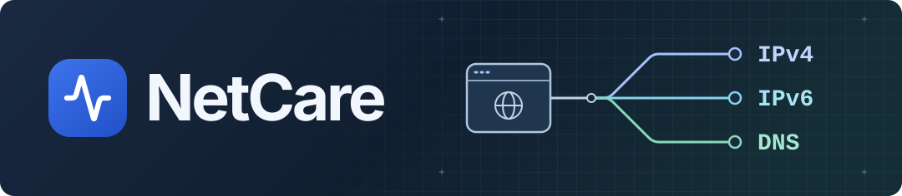

<h1 align="center">
  
</h1>

<p align="center"><strong>English</strong> · <a href="./README_CN.md" lang="zh-CN">简体中文</a></p>

**Which IP does a website see when you connect?** With split tunneling, your browser can reach Tencent through one exit and the npm registry through another. NetCare runs probes from your browser so you can check your proxy or VPN rules against the addresses each destination actually sees.

## Quick start

Use Yarn Classic 1.22.22 with Node.js 20.19+ on the 20.x line, or Node.js 22.12 and later. The public probes work without API keys.

```sh
git clone https://github.com/gofxq/netcare.git
cd netcare
yarn install --frozen-lockfile
yarn dev
```

Open the local URL printed by Vite. The dashboard is in Simplified Chinese. Choose **网站分流测试** (split tunneling) and compare the exit IPs for **腾讯** (Tencent) and `registry.npmjs.org`. Change a routing rule and click **重新测试** (retest) to see its effect.

## Explore the dashboard

| Tool | Route | What you can check |
| --- | --- | --- |
| **Public IP** | `/` | Check IPv4 and IPv6 separately with IP.SB. Compare the addresses reported by iP138, IP.cn, Cloudflare, and IPinfo, then see HTTP response times for eight sites. |
| **Split tunneling** | `/split-tunnel` | Compare exit IPs and locations across 42 targets. Filter by mainland China or international sites and scroll to run more checks. |
| **Multiple exits** | `/multi` | See which public probes observed the same exit IP. Expand an address to inspect the probes by region, or stop the scan and keep the results so far. |
| **DNS exit** | `/dns-exit-lookup` | See the outbound IP of each recursive resolver that contacted the DNS probe, alongside its reported location. |
| **IP lookup** | `/query` | Compare location, autonomous system number (ASN), and ISP across sources. Share a lookup by copying its URL, for example `/query?q=8.8.8.8`. |

**Sharing a screenshot?** The home page has separate switches to mask IP addresses, details from mainland Chinese providers, and details from international providers. Probes still contact those services while masking is on.

**Missing a result?** Some providers restrict cross-origin requests or rate-limit lookups. Retry the individual check, or use the link on the iP138 card to open that service directly.

## Build and host

```sh
yarn test
yarn build
yarn preview
```

The build writes an `index.html` for each of the five routes. To host the browser probes and public IP lookups, publish the contents of `dist/` at the root of a static site with directory indexes enabled.

To add a site to the split-tunnel or latency checks, start with the [target catalog](./src/catalog.js). To add an IP lookup provider, see the [source definitions](./src/geo-sources.js).

## Optional IP lookup sources

IP lookup can query 13 public sources directly from the browser. To compare their results with a local MMDB database or a provider you subscribe to, add its setting to `.env.local` in the project root. For GeoLite2 City, use the absolute path to your database file.

```dotenv
NETCARE_GEOLITE2_MMDB=/absolute/path/to/GeoLite2-City.mmdb
```

Restart `yarn dev` or `yarn preview` and open the app on localhost. The local Vite service reads the database files and sends authenticated requests using your keys.

<details>
<summary>All nine optional sources and their settings</summary>

| Source | Environment variable |
| --- | --- |
| DB-IP City Lite (MMDB) | `NETCARE_DBIP_MMDB` |
| GeoLite2 City (MMDB) | `NETCARE_GEOLITE2_MMDB` |
| IPIP.net 2023 (MMDB) | `NETCARE_IPIP_MMDB` |
| CZ88 (MMDB) | `NETCARE_CZ88_MMDB` |
| IP-API Pro | `NETCARE_IP_API_KEY` |
| ipdata | `NETCARE_IPDATA_KEY` |
| GEO IPIFY | `NETCARE_IPIFY_KEY` |
| ipregistry | `NETCARE_IPREGISTRY_KEY` |
| IPstack | `NETCARE_IPSTACK_KEY` |

</details>

## Credit

NetCare’s diagnostics were inspired by [Sukka’s IP tools](https://ip.skk.moe/).
