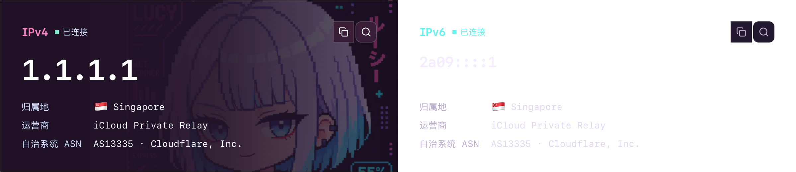

<h1 align="center">NetCare</h1>

<p align="center"><a href="./README.md" lang="en">English</a> · <strong>简体中文</strong></p>

**你访问不同网站时，对方看到的是同一个 IP 吗？** 开了分流之后，浏览器访问腾讯和 npm 仓库可能走两个出口。NetCare 直接从浏览器发起探测，把各个目标看到的 IP 列出来，方便你核对代理或 VPN 规则有没有按预期生效。



## 快速开始

使用 Yarn Classic 1.22.22。Node.js 可选 20.19 及以上的 20.x 版本，或 22.12 及以上版本。运行公开探测无需 API 密钥。

```sh
git clone https://github.com/gofxq/netcare.git
cd netcare
yarn install --frozen-lockfile
yarn dev
```

打开终端里 Vite 给出的本地地址，进入 **网站分流测试**，对比 **腾讯** 和 `registry.npmjs.org` 两行的出口 IP。修改一条分流规则后，点 **重新测试**，就能核对它是否生效。

## 五个诊断页面

| 工具 | 路径 | 能查什么 |
| --- | --- | --- |
| **本机 IP 查询** | `/` | 通过 IP.SB 分别检测 IPv4 和 IPv6，对照 iP138、IP.cn、Cloudflare、IPinfo 看到的地址，查看八个站点的 HTTP 响应耗时。 |
| **网站分流测试** | `/split-tunnel` | 对比 42 个目标的出口 IP 和归属地，可按国内、国际筛选。向下滚动时会继续检测。 |
| **多出口 IP 查询** | `/multi` | 按出口 IP 汇总公网探针的观测结果。展开地址可按地区查看探针，中途停止也会保留已有结果。 |
| **DNS 出口查询** | `/dns-exit-lookup` | 查看哪个递归 DNS 解析器向探针发起了查询，以及该解析器的出口 IP 和归属地。 |
| **IP 洞察** | `/query` | 对照多个数据源给出的归属地、自治系统编号（ASN）和运营商。复制查询页地址即可分享，例如 `/query?q=8.8.8.8`。 |

**想分享截图？** 首页有三个独立开关，可以分别隐藏 IP 地址、国内来源信息和国际来源信息。开关只影响页面显示，浏览器仍会向服务商发起请求。

**有一项没查到？** 个别数据源会限制跨域访问或请求频率，可以单独重试。iP138 卡片还提供了直达链接，方便去服务商页面核对。

## 构建与部署

```sh
yarn test
yarn build
yarn preview
```

构建时会为五个页面分别生成 `index.html`。将 `dist/` 里的内容放在静态站点根目录，并启用目录索引，即可使用浏览器探测和公开数据源查询。

想添加分流或延迟测试站点，可以从[探测目标列表](./src/catalog.js)入手。要为 IP 洞察接入新的服务商，可以参考[数据源定义](./src/geo-sources.js)。

## 为 IP 洞察添加数据源

IP 洞察可从浏览器直接查询 13 个公开数据源。如果手头有 MMDB 数据库或服务商提供的 API 密钥，可以在项目根目录的 `.env.local` 中添加对应配置。例如，使用本地 GeoLite2 City 数据库时，填写文件的绝对路径。

```dotenv
NETCARE_GEOLITE2_MMDB=/absolute/path/to/GeoLite2-City.mmdb
```

重启 `yarn dev` 或 `yarn preview`，通过 localhost 打开应用。数据库文件由本机的 Vite 服务读取，需要密钥的请求也由该服务发出。

<details>
<summary>查看全部 9 个可选数据源及配置项</summary>

| 数据源 | 环境变量 |
| --- | --- |
| DB-IP City Lite（MMDB） | `NETCARE_DBIP_MMDB` |
| GeoLite2 City（MMDB） | `NETCARE_GEOLITE2_MMDB` |
| IPIP.net 2023（MMDB） | `NETCARE_IPIP_MMDB` |
| 纯真 CZ88（MMDB） | `NETCARE_CZ88_MMDB` |
| IP-API Pro | `NETCARE_IP_API_KEY` |
| ipdata | `NETCARE_IPDATA_KEY` |
| GEO IPIFY | `NETCARE_IPIFY_KEY` |
| ipregistry | `NETCARE_IPREGISTRY_KEY` |
| IPstack | `NETCARE_IPSTACK_KEY` |

</details>

## 致谢

NetCare 的诊断功能参考了 [Sukka 的 IP 工具](https://ip.skk.moe/)。
